# Missing Person — TryHackMe Walkthrough

[](https://tryhackme.com/room/missingperson)
[]()
[]()


A walkthrough of the **Missing Person** room on TryHackMe — a beginner OSINT investigation built around two photos, a last-known message, and a trail of social media accounts. Starting from two image files, the goal is to reconstruct the missing person's movements step by step using metadata, reverse image search, and social media pivoting.

**Room:** https://tryhackme.com/room/missingperson

> **Scenario:** *"My friend went on holiday in 2025 and shared some photos, but I haven't heard from him since. Can you help me track him down for the police report?"*

---

## The Evidence

The attached zip contained two photos:

- **`MotoGP.jpg`** — a photo taken at a racing event
- **`food.jpg`** — a photo of a meal he ate

```bash
unzip osint-1767765507985.zip
```

Both files are the starting point for all seven tasks — everything is derived from these two images.

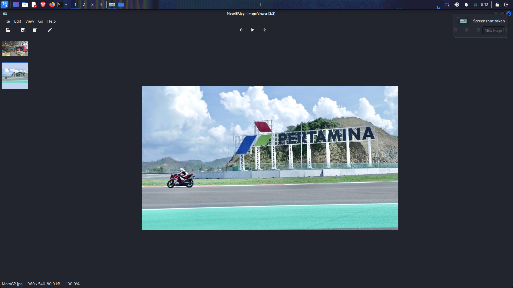
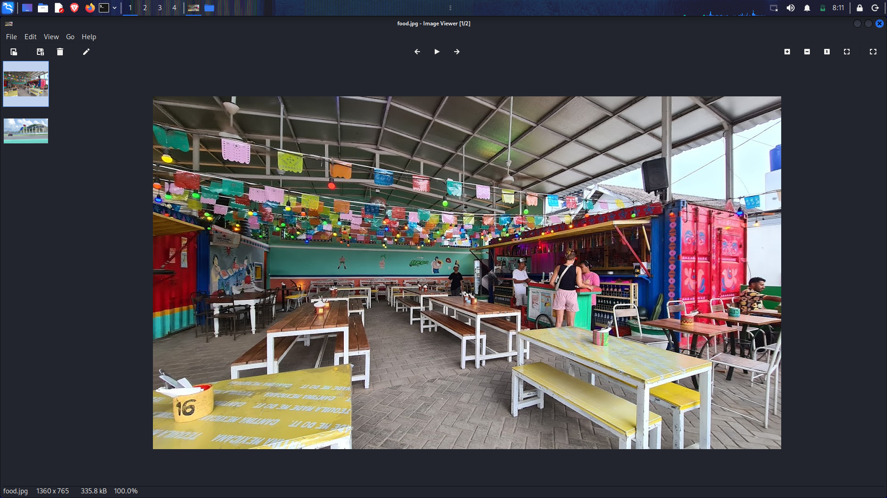

---

## Task 1 — What is the commercial name of the circuit?

**Format:** English, full commercial name.

### Method: Reverse Image Search

**Why reverse image search?**
The photo shows a racing circuit from a spectator's angle — no text, signage, or GPS data visible in the image itself. Reverse image search sends the image to Google's index and matches it visually against billions of indexed photos. Any photo of this same venue taken by anyone else — press, fans, official photographers — will surface a name for it.

**Steps:**
1. Open [images.google.com](https://images.google.com).
2. Click the camera icon → upload `MotoGP.jpg`.
3. Google matches the visual layout of the circuit against known photos.

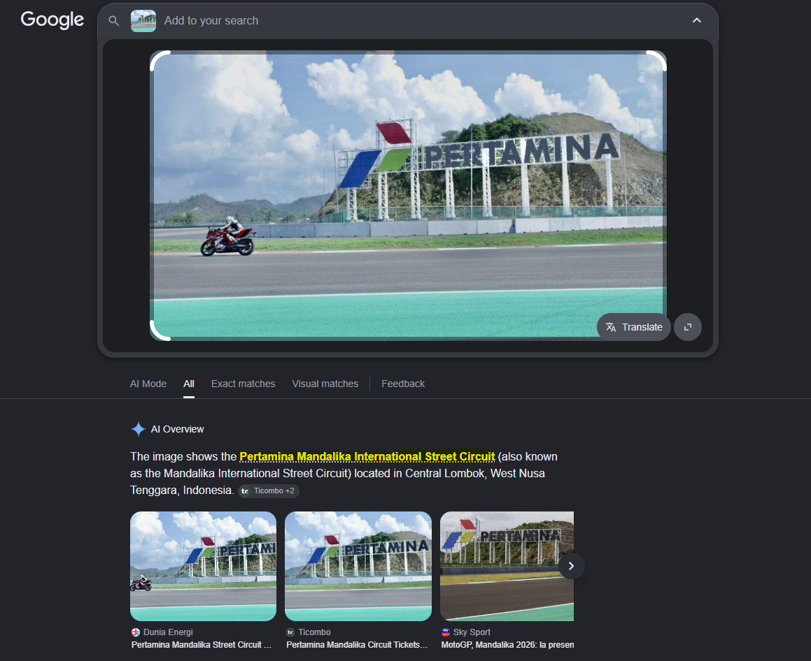

**Answer:** `Pertamina Mandalika International Street Circuit`

The circuit is located in **Lombok, Indonesia** — this immediately narrows the geographic scope of the investigation.

---

## Task 2 — When did the event take place?

**Format:** DD-DD/MM/YYYY

### Method: EXIF Metadata Extraction with `exiftool`

**Why exiftool?**
Every photo taken by a camera or smartphone embeds **EXIF metadata** (Exchangeable Image File Format) inside the file itself — information like the date/time of capture, GPS coordinates, camera model, and exposure settings. This data is invisible when viewing the image normally but is readable with any EXIF tool. `exiftool` is the standard Linux command-line tool for this.

```bash
exiftool MotoGP.jpg
```

**Why this command:**
`exiftool` with just a filename reads and prints every metadata field in the file. No flags needed for basic extraction — the output includes `Date/Time Original`, which records exactly when the shutter fired.

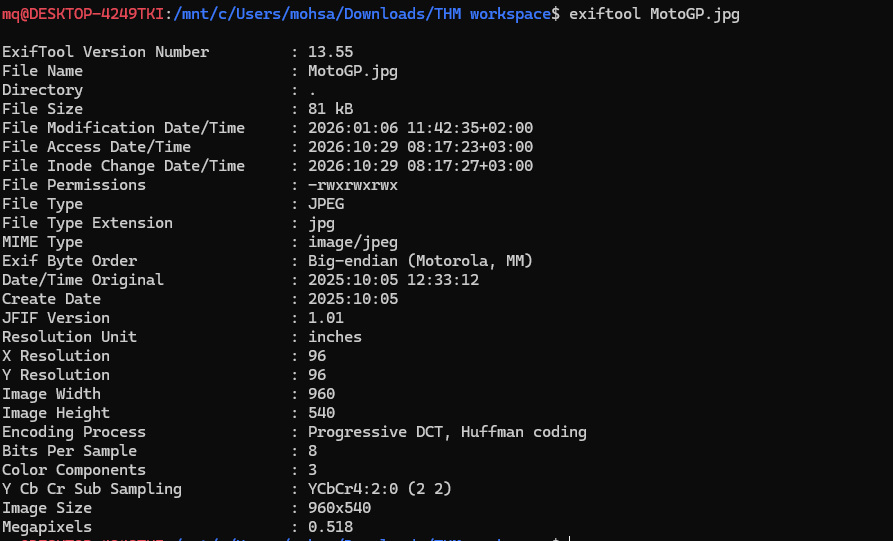

The metadata returned the capture date. Cross-referencing that date with the known MotoGP race calendar for Mandalika confirmed the event window.

**Answer:** `03–05/10/2025`

---

## Task 3 — What is the name of the restaurant?

**Clue:** *"He told me he ate delicious Mexican food."*

### Method: Reverse Image Search on the Food Photo

**Why reverse image search again?**
The food photo shows a restaurant setting. Rather than guessing, feeding the image to Google reverse search looks for the same photo posted anywhere online — restaurant review sites, Google Maps listings, Instagram posts, TripAdvisor. Any match will identify the venue by name.

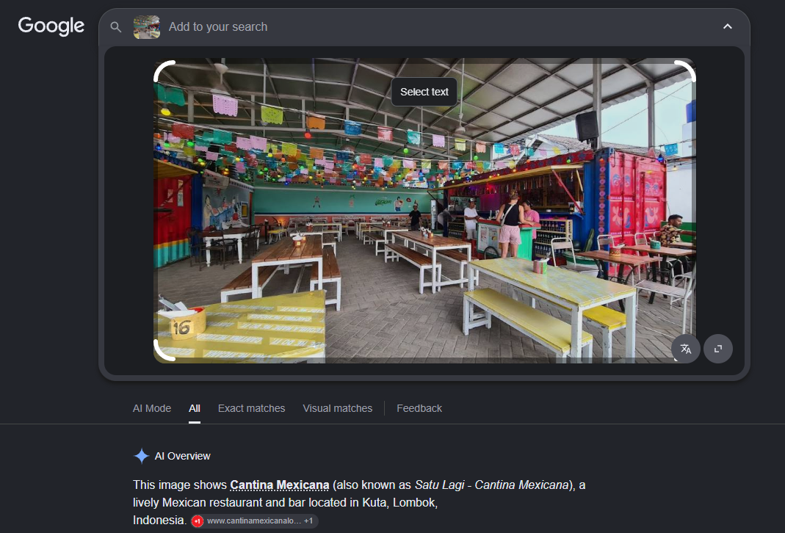

The search returned results pointing to a Mexican restaurant in the Mandalika/Lombok area — consistent with the MotoGP circuit location already established in Task 1.

**Answer:** `Cantina Mexicana`

---

## Task 4 — At what time was the food photo taken?

**Format:** HH:MM:SS

### Method: EXIF Metadata Extraction on `food.jpg`

**Why exiftool again?**
Same logic as Task 2 — EXIF metadata records the exact time of capture. Knowing *when* a photo was taken can be used to cross-reference location check-ins, social media posts, or CCTV timelines in a real investigation.

```bash
exiftool food.jpg
```

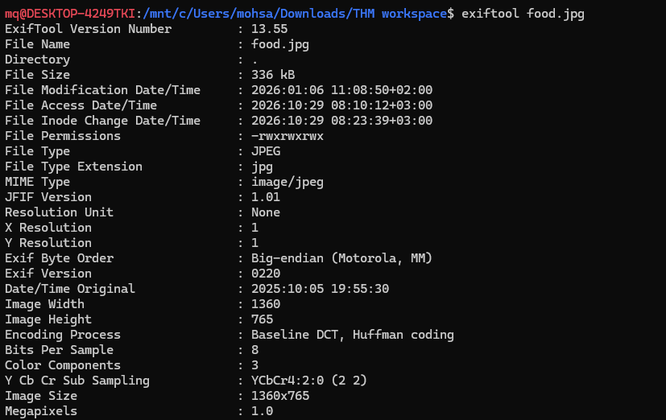

The `Time Original` field in the metadata returned the exact timestamp.

**Answer:** `19:55:30`

---

## Task 5 — What is the full address of the bar?

**Last known message:** *"Went to this cool MotoGP after party, and became friends with one of the local DJs who played that night. We're going to visit a cave tomorrow."*

### Method: Social Media Search (OSINT Pivoting)

**Why OSINT pivoting?**
The message gives three new intelligence leads to chase simultaneously:
- A **location** (Mandalika, Lombok)
- An **event** (MotoGP after party, early October 2025)
- A **person type** (local DJ who played that night)

No single data point is enough — the strategy is to combine all three into a search query and look for posts from people who were actually *there* and posted about it publicly.

**Search approach:**
Searched Instagram and Google with keyword combinations like:
- `Mandalika after party MotoGP October 2025`
- `Mandalika MotoGP after party DJ local`

This surfaced a public Instagram post from the event that mentioned the bar and tagged or referenced the DJ who performed.

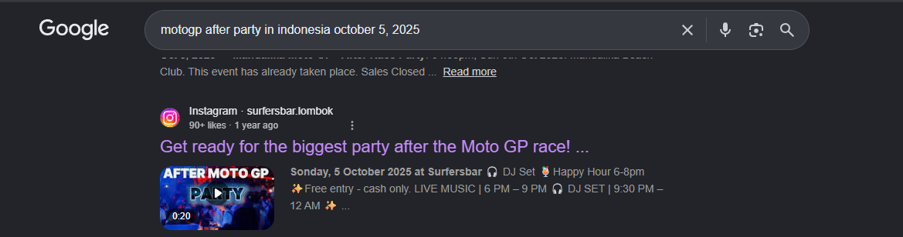

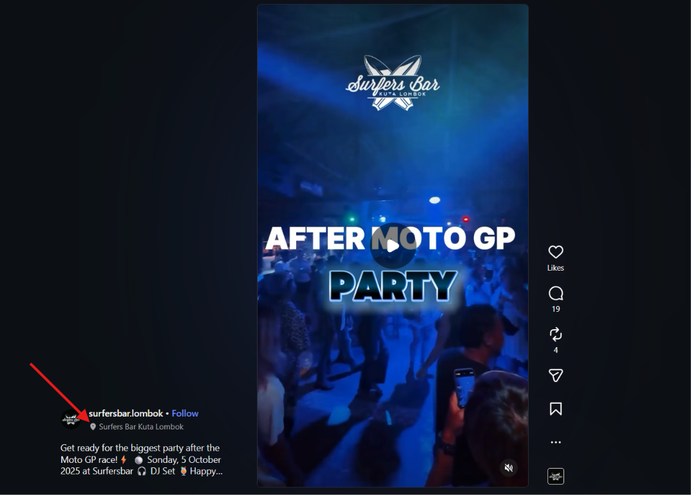

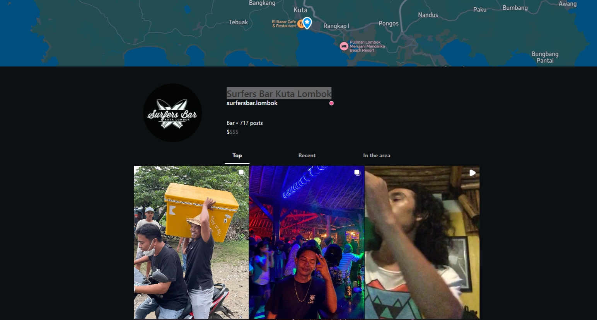

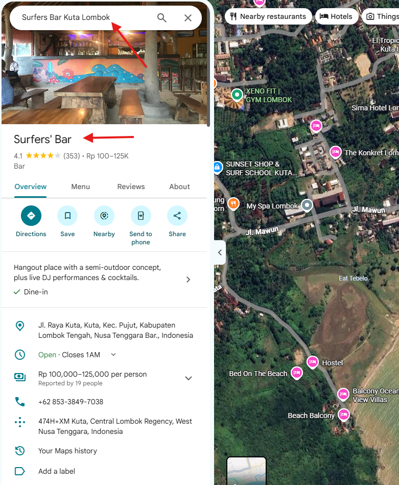

**Answer:** `Jl. Raya Kuta, Kuta, Kec. Pujut, Kabupaten Lombok Tengah, Nusa Tenggara Bar`

---

## Task 6 — What is the DJ's stage name?

### Method: Reading the Instagram Post

The same Instagram post that surfaced the bar's address also tagged or named the DJ who performed at the after party.

**Why this works:**
Event promoters and venues almost always tag performing artists in their posts. The artist themselves will also often post about gigs. Cross-referencing the venue, date, and "local DJ" description against who was tagged in posts from that event narrows it to one person.

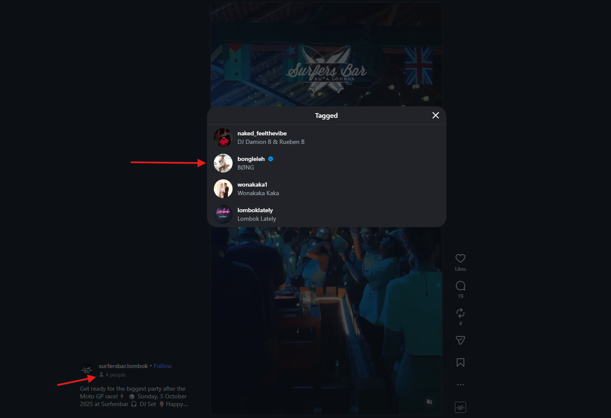

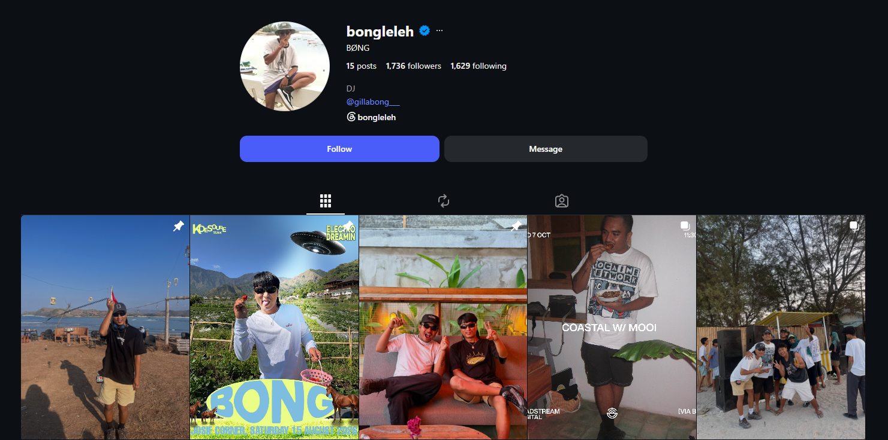

**Answer:** `BONG LELEH`

---

## Task 7 — What cave does the DJ take tourists to? And what is his contact number?

### Method: Cross-Platform Social Media Pivoting (Instagram → Facebook)

**Why pivot to a second platform?**
The missing person's last message said the DJ planned to take him to a cave "tomorrow." Instagram accounts are often curated for public image — older, more personal, or business-related posts may live on Facebook instead. Searching for the DJ's name across platforms finds accounts he may not actively maintain but still contain useful information.

**Steps:**
1. Search Facebook for `BONG LELEH` or `Bong Leleh DJ Lombok`.
2. Locate his older Facebook page (less active than Instagram).
3. Look for posts, check-ins, or listed information about cave tours or tour services.

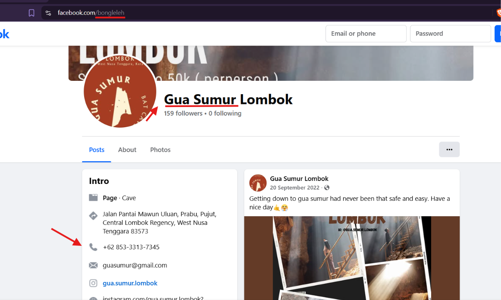

The Facebook page listed:
- The cave he guides tourists to: **Gua Sumur**
- A contact number for his tour business

**Answers:**
- Cave: `Gua Sumur`
- Phone number: `85333137345`

---

## Investigation Timeline

```
[START] Two image files: MotoGP.jpg + food.jpg
    │
    ├─ MotoGP.jpg ──► Reverse image search ──► Pertamina Mandalika Circuit, Lombok
    │                                           (Task 1)
    │
    ├─ MotoGP.jpg ──► exiftool ──► Date: 03–05/10/2025
    │                               (Task 2)
    │
    ├─ food.jpg ───► Reverse image search ──► Cantina Mexicana restaurant
    │                                          (Task 3)
    │
    ├─ food.jpg ───► exiftool ──► Time: 19:55:30
    │                              (Task 4)
    │
    ├─ Last message + location pivot ──► Instagram search
    │   └─ Mandalika + MotoGP + after party + October 2025
    │       ├─ Bar address: Jl. Raya Kuta, Lombok (Task 5)
    │       └─ DJ stage name: BONG LELEH (Task 6)
    │
    └─ DJ name ──► Facebook pivot ──► Cave: Gua Sumur
                                       Phone: 85333137345
                                       (Task 7)
```

---

## OSINT Toolkit Used

| Tool | Purpose |
|------|---------|
| Google Reverse Image Search | Identify location/venue from photos without visible text |
| `exiftool` | Extract EXIF metadata (date, time, GPS) from image files |
| Instagram search | Find event-related posts using keyword combinations |
| Facebook search | Cross-platform pivot to find older/business accounts |

---

## Key OSINT Lessons

**1. Start with what the file itself tells you.**
Before searching anywhere, always run `exiftool` on every image. Metadata is often overlooked and can give you date, time, and GPS in seconds.

**2. Each answer narrows the next search.**
The circuit name → the country → the event date → the after-party posts → the DJ → the cave. OSINT is a chain; every piece you confirm makes the next search more precise.

**3. People cross-post between platforms inconsistently.**
Instagram may have the DJ's gig posts, but Facebook might have his tour business contact. Never stop at one platform.

**4. Public event posts are a goldmine.**
Any large public event (like a MotoGP race) generates thousands of public posts from attendees, venues, and performers. Combining event name + date + location with the role of the person you're looking for (local DJ) quickly surfaces a short list of candidates.

---

## Disclaimer

This walkthrough documents work performed on a TryHackMe lab room for educational purposes. All OSINT techniques demonstrated here were used against fictional scenario data within a controlled lab environment. In real investigations, always operate within legal boundaries and with appropriate authorisation.
